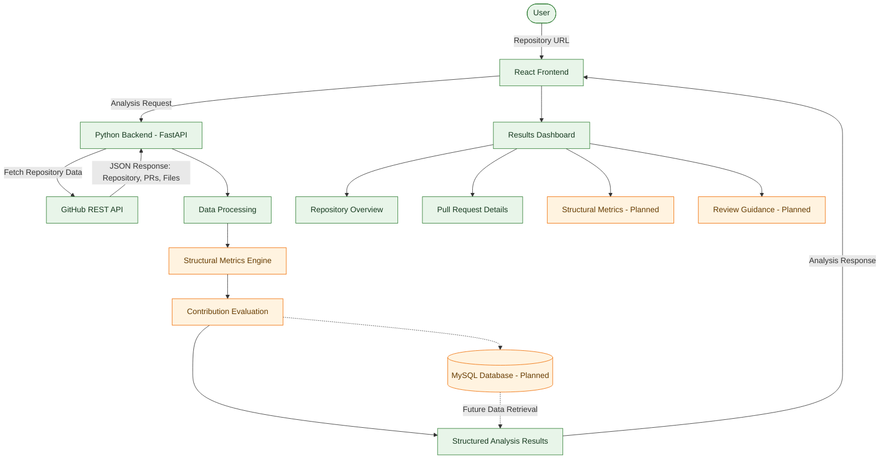

# PRISM — Pull Request Intelligence & Structural Metrics


## Overview

- **PRISM** is a GitHub-integrated code intelligence tool designed to analyze, evaluate, classify, and rank Pull Requests (PRs) based on their code quality, contribution significance, and impact on the existing codebase.
- By connecting a GitHub repository through our extension, developers can examine incoming and historical Pull Requests through a structured evaluation system. Rather than treating every merged PR equally, PRISM aims to identify contributions that improve code maintainability, fix meaningful issues, enhance performance, strengthen testing, improve architecture, or introduce valuable functionality.
 -The results are presented through an interactive dashboard featuring categorized PRs, impact scores, hierarchical rankings, and visual representations of how individual contributions affect the overall repository.
- PRISM is intended to support developers, maintainers, open-source contributors, and engineering teams in making more informed decisions about code contributions.

## The Problem

- High-level developers, open-source maintainers, and organizations often receive hundreds of Pull Requests (PRs) daily, making it difficult to review every contribution efficiently and consistently.
- Not all PRs contribute equally. While some improve code quality, fix critical issues, or enhance performance, others may introduce complexity or offer minimal value. Identifying and prioritizing impactful contributions across large repositories is a significant challenge.
- PRISM addresses this problem by automating PR classification, evaluating code quality and contribution impact, and presenting results through hierarchical rankings and interactive visualizations—helping maintainers make faster, more informed review decisions.

## Proposed Solution

PRISM proposes a GitHub-integrated analysis platform that collects pull request information, processes relevant repository data, and organizes the results into interpretable metrics.

The system follows a modular approach:
- Repository integration: Accept a GitHub repository URL and identify the repository to analyze.
- Data extraction: Retrieve pull requests and relevant repository metadata through the GitHub REST API.
- Data processing: Organize pull request details, changed-file information, and available structural data into a consistent representation.
- Structural analysis: Calculate useful metrics describing the size, distribution, and characteristics of code changes.
- Contribution evaluation: Develop a multi-dimensional evaluation framework for comparing contributions using measurable criteria.
- Visualization: Present repository and pull request information through an interactive web dashboard.
- Review assistance: Help maintainers identify changes that may need closer inspection, while keeping final decisions under human control.

The long-term objective is to move beyond displaying pull request information and toward explaining what changed, how substantial the change is, and what aspects deserve a closer review.

## Project Vision
PRISM aims to make pull request review more systematic by combining
GitHub data retrieval, interpretable structural metrics, and a clear
dashboard. The long-term objective is to help maintainers understand
what changed, how broadly the codebase is affected, and what deserves
closer review.

## System Architecture

The diagram below shows the intended end-to-end architecture. Components
marked as planned are not claims that the functionality is already
implemented.



### Legend
- 🟢 Green: Implemented or integration in progress
- 🟠 Orange: Planned or under development
- Dashed arrows: Future database integration
```
```

## Project Structure

    PRISM/
├── frontend/
│   ├── src/
│   │   ├── assets/
│   │   ├── App.jsx
│   │   ├── App.css
│   │   ├── index.css
│   │   └── main.jsx
│   ├── package.json
│   └── vite.config.js
├── data/
│   └── raw/             # Local development data; do not commit
├── API_manage.py        # GitHub API integration
├── backend.py           # Python backend entry point
├── .gitignore
└── README.md

